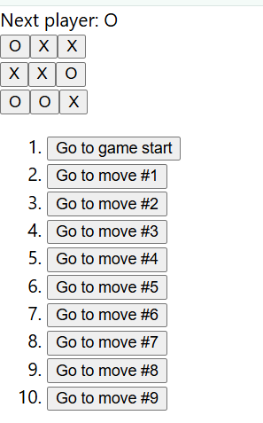

# Tic-Tac-Toe in React

An interactive two-player tic-tac-toe game built with React. Players take turns placing X and O on a 3x3 board, and the game detects wins and draws automatically.

**[Live Demo](https://hooman-tictactoe.netlify.app/)**



## Features

- Two-player gameplay with alternating X and O turns
- Win detection across all rows, columns, and diagonals
- Draw detection when the board is full
- Prevents moves on already-filled squares
- Restart button to start a new game

<!-- Add or remove features to match what your game actually does, e.g. move history, score tracking, AI opponent -->

## Built With

- React (functional components and hooks)
- JavaScript (ES6+)
- HTML/CSS

## Getting Started

### Prerequisites

- [Node.js](https://nodejs.org/) (v18 or newer recommended)

### Run Locally

1. Clone the repository:

   ```bash
   git clone https://github.com/hoomanv3xo/tic-tac-toe-react.git
   cd tic-tac-toe-react
   ```

2. Install dependencies:

   ```bash
   npm install
   ```

3. Start the development server:

   ```bash
   npm start
   ```

   (If the project was created with Vite, use `npm run dev` instead.)

4. Open the local address shown in the terminal (usually `http://localhost:3000` or `http://localhost:5173`).

## How It Works

The game state (board squares and whose turn it is) is held in React state with `useState`. After every move, the app checks the board against the eight possible winning lines to determine whether there is a winner, a draw, or the game should continue.

## What I Learned

- Structuring a UI into reusable React components
- Managing state and re-rendering with hooks
- Lifting state up and passing data through props
- Implementing game logic separately from UI code

## Future Improvements

- Move history with "jump to move"
- Single-player mode with a minimax AI opponent
- Score tracking across rounds

## Author

**Hooman Vahdat**
[LinkedIn](https://linkedin.com/in/hoomanvahdat) | [Portfolio](https://hooman-codes.ca) | [GitHub](https://github.com/hoomanv3xo)

